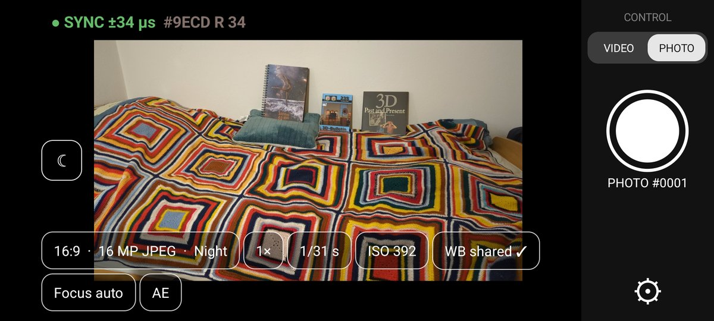

# SyncCamPhone

Synchronised (genlocked) stereo photos and videos with two (or more) Android phones.

One phone is the **CONTROL** phone; the other phones are **camera phones** that follow it. The phones share
a common clock over Wi-Fi and take each photo, and record each video frame, at the same moment - typically
within a few hundredths of a millisecond. The left and right files can then be combined into 3D photos or
videos with any stereo software (for example with [StereoMate](https://github.com/crunchy3d/StereoMate/)).



## Features

- **Stereo photos**: JPEG, RAW (DNG) or both, with the same exposure, white balance and focus on all phones
- **HDR** and automatic **Night** averaging, merged on the phone (GPU)
- **Astro**: long exposure series (up to 16 s frames) on a tripod
- **Time-lapse**: synchronised stereo photos at a fixed interval
- **Stereo video** up to 4K, frame-locked between the phones, with sound; VBR or CBR
- **Anti-flicker** (50 / 60 Hz) against stripes under mains lamps, in photos and videos
- **Lenses**: main, ultra-wide (video) and front camera, chosen on the CONTROL phone
- **MONO** mode for a single phone
- **Remote trigger** (experimental): presses the shutter of Google Camera, Blackmagic Camera or other
  camera apps on all phones at the same moment

## Phones

Tested with **Google Pixel 7a** (recommended), **Pixel 4** and **Xreal Beam Pro** (only left lens). Use two
phones of the same model. Other Android phones (8.0 or newer) may work if their camera allows manual frame
timing - **Probe (camera tests) -> Timing test** in the app tells you.

## Download and install

1. Download `SyncCamPhone_V0_105.apk` from the [Releases](../../releases) page on each phone.
2. Download it with **Chrome** and open it from Chrome's download message; allow Chrome to "install unknown
   apps" when Android asks. (Opening the APK in Files by Google or Firefox may end with "The app wasn't
   installed" on some phones.)
3. Start **SyncCamPhone** and allow camera, microphone and photos access.

Read the **[User Manual (PDF)](docs/SyncCamPhone_User_Manual_V0_105.pdf)** before the first use. Also in
[German](docs/SyncCamPhone_User_Manual_V0_105_DE.pdf), [French](docs/SyncCamPhone_User_Manual_V0_105_FR.pdf),
[Dutch](docs/SyncCamPhone_User_Manual_V0_105_NL.pdf) and [Slovene](docs/SyncCamPhone_User_Manual_V0_105_SL.pdf)
(the app itself is in English; the manuals keep its button and setting names in English).

## Quick start

1. Turn on the Wi-Fi hotspot on the CONTROL + CAMERA (or CONTROL only) phone and connect the camera
   phones to it.
2. Start the app on all phones: **CONTROL + CAMERA** on one, **CAMERA** on the other.
3. Choose the camera position (LEFT / RIGHT) and wait for the green **SYNC**.

Photos and videos are saved in `Download/SyncCamPhone` on every phone, with names ending in `-l` / `-r`.

You can also use one **CONTROL only** phone that takes no pictures, together with two (or more) CAMERA
phones: it synchronises and triggers them.

## Building from source

Requirements: Android SDK and JDK 17. The PowerShell script is for Windows; on other systems use
`./gradlew assembleDebug`.

```powershell
.\build.ps1             # build app\build\outputs\apk\debug\app-debug.apk
.\build.ps1 -Install    # build and install on all phones connected with USB debugging
```

The internal application ID is `com.crunchy3d.synccamphone`.

The manual is generated with Python (ReportLab, Pillow): `python docs/manual/make_manual.py`.

## How the sync works

- The phones estimate their clock offsets from UDP round trips (a least-squares fit over the fastest
  exchanges).
- Every camera runs with manual exposure and a fixed frame duration; the frame phase is steered by briefly
  changing `SENSOR_FRAME_DURATION` (as in Google's libsoftwaresync / RecSync), so the frames of all phones
  start at the same time.
- A photo uses the frame closest to the agreed moment on every phone; the time difference is reported after
  each photo.

## Authors

Damir Vrancic and Claude

## License

[MIT](LICENSE) - Copyright (c) 2026 Damir Vrancic
